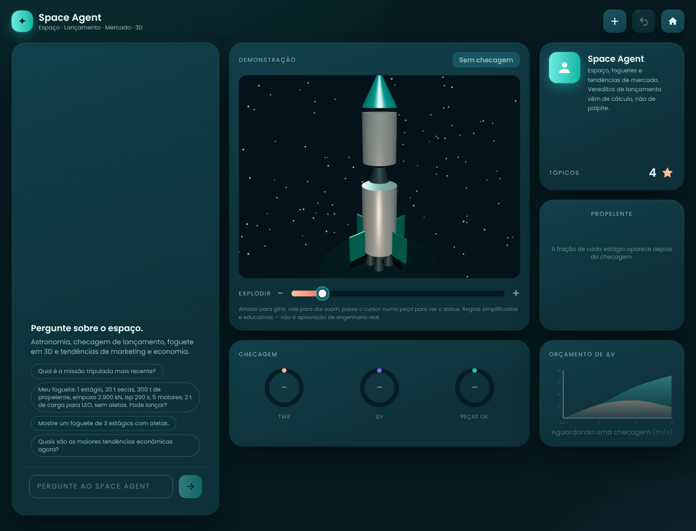

# Space Agent

Agente de IA que responde sobre espaço e astronomia, diz se uma nave pode lançar,
comenta tendências de marketing e economia e mostra um foguete 3D interativo com
as peças com defeito em vermelho. Feito a partir do PRD *Space AI Agent*, com o
design system “Turquesa”.



- **Análise completa da estrutura:** [`docs/ANALISE.md`](docs/ANALISE.md)
- **Design system:** [`docs/DESIGN-SYSTEM.md`](docs/DESIGN-SYSTEM.md)

## Rodar

Precisa de Node 22+ e a chave de alguma IA (veja abaixo).

```bash
npm install
cp .env.example .env.local   # e preencha a chave da IA escolhida
npm run dev                  # http://localhost:3000
```

## Qual IA usar

O app funciona com qualquer IA. Na Vercel (Settings → Environment Variables) ou
no `.env.local`, preencha **uma** das opções. Se houver mais de uma, vale a
primeira desta lista:

| IA | Variáveis | Busca na web |
|---|---|---|
| Qualquer API compatível com a da OpenAI | `AI_API_KEY`, `AI_BASE_URL`, `AI_MODEL` | Não |
| Claude (Anthropic) | `ANTHROPIC_API_KEY` | Sim, com fontes |
| Grok (xAI) | `XAI_API_KEY` | Não |
| OpenAI | `OPENAI_API_KEY`, `AI_MODEL` | Não |

`AI_MODEL` troca o modelo em qualquer opção. O Grok usa `grok-4.6` por padrão;
se a xAI disser que o modelo não existe, coloque em `AI_MODEL` o nome que aparece
no painel da xAI.

Exemplos de `AI_BASE_URL` para a opção genérica:

- Gemini: `https://generativelanguage.googleapis.com/v1beta/openai/`
- Groq: `https://api.groq.com/openai/v1`
- OpenRouter: `https://openrouter.ai/api/v1`

A checagem de lançamento e o foguete 3D funcionam igual com qualquer IA — são
cálculo do próprio app. Sem busca na web, a IA avisa que perguntas sobre
notícias recentes podem estar desatualizadas.

Depois de mudar uma variável na Vercel, faça um **Redeploy** para ela valer.

## Testar

```bash
npm test           # checagem de lançamento, escolha da IA e loop do agente (Vitest)
npm run typecheck
npm run build
```

## Experimente perguntar

- “Qual é a missão tripulada mais recente?”
- “Meu foguete: 1 estágio, 20 t secas, 300 t de propelente, empuxo 2.900 kN,
  Isp 290 s, 5 motores, 2 t de carga para LEO, sem aletas. Pode lançar?”
- “Mostre um foguete de 3 estágios com aletas.”
- “Quais são as maiores tendências econômicas agora?”

## Como funciona, em uma linha

O navegador manda a conversa para `/api/chat`; o servidor roda o loop do agente
(a IA configurada + `check_launch` + `show_rocket`, e `web_search` no Claude) e devolve texto, checagem
e modelo 3D em streaming. As regras de lançamento são simplificadas e educativas —
não são aprovação de engenharia real.
