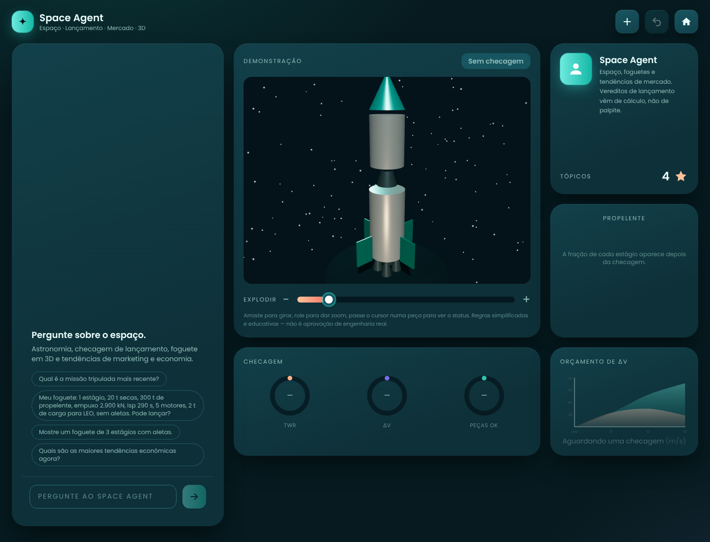

# Space Agent

Laboratório de foguetes com um agente de IA. Monte o seu foguete com motores e
materiais reais, veja o desempenho e o custo, monte o plano de financiamento e
**lance** — com animação 3D, telemetria e falhas que viram cena. O agente
responde sobre espaço, economia e mercado, e também altera e lança o foguete por você.
Feito a partir do PRD *Space AI Agent*, com o design system “Turquesa”.

## O que dá para fazer

- **Construir**: partir de Falcon 9, Electron, Saturn V ou Atlas V, ou do zero; escolher 1 a 3 estágios, propelente (querosene, metano, hidrogênio), motor real, quantidade, propelente no tanque, material, diâmetro, propulsores laterais, estabilidade (aletas ou gimbal), reutilização, carga útil e destino (órbita baixa, GTO ou Lua). Salvar projetos.
- **Desempenho**: checagem do PRD, empuxo/peso, Δv por estágio, carga máxima para cada órbita e para onde vai a massa.
- **Finanças**: custo por lançamento, custo por kg comparado ao mercado, custo de desenvolvimento e plano de negócio — preço, lançamentos por ano, investidores, contratos do governo, empréstimo e tempo de retorno.
- **Missão**: simulação da subida segundo a segundo, com animação 3D, tela cheia, controle de velocidade (1×, 10×, 50×), trajetória, gráficos e linha do tempo.
- **Agente**: "troque para metano", "deixe mais barato por kg", "lance o foguete", "o que minha empresa deve fazer?" — ele muda o projeto e explica com os números do app.
- **Empresa** (modo 🏢): comece com US$ 100 milhões, dê um nome, escolha o país num **globo 3D** (10 países com base de lançamento real), desenvolva foguetes, faça contatos, aceite investidores, contratos do governo ou empréstimos, cumpra missões pagas (com incentivo do país), abra capital (IPO) e tente chegar a US$ 1 bilhão sem falir.
- **Tutorial animado** de ~1 minuto na primeira visita (botão **?** no topo para rever), com narração opcional e **música** ambiente gerada ao vivo (botão 🎵).
- **Botões ?** ao lado de cada termo explicam tudo em linguagem simples.

Roteiro para apresentar em 6–7 minutos: [`docs/APRESENTACAO.md`](docs/APRESENTACAO.md).

Os números são aproximados e educativos. Fontes em [`docs/DADOS.md`](docs/DADOS.md).



- **Análise completa da estrutura:** [`docs/ANALISE.md`](docs/ANALISE.md)
- **Design system:** [`docs/DESIGN-SYSTEM.md`](docs/DESIGN-SYSTEM.md)

## Rodar

Precisa de Node 22+ e a chave de alguma IA (veja abaixo).

```bash
npm install
cp .env.example .env.local   # e preencha a chave da IA escolhida
npm run dev                  # http://localhost:3000
```

## Qual IA usar

O app funciona com qualquer IA. Na Vercel (Settings → Environment Variables) ou
no `.env.local`, preencha **uma** das opções. Se houver mais de uma, vale a
primeira desta lista:

| IA | Variáveis | Busca na web |
|---|---|---|
| Qualquer API compatível com a da OpenAI | `AI_API_KEY`, `AI_BASE_URL`, `AI_MODEL` | Não |
| Claude (Anthropic) | `ANTHROPIC_API_KEY` | Sim, com fontes |
| Grok (xAI) | `XAI_API_KEY` | Não |
| OpenAI | `OPENAI_API_KEY`, `AI_MODEL` | Não |

`AI_MODEL` troca o modelo em qualquer opção. O Grok usa `grok-4.6` por padrão;
se a xAI disser que o modelo não existe, coloque em `AI_MODEL` o nome que aparece
no painel da xAI.

Exemplos de `AI_BASE_URL` para a opção genérica:

- Gemini: `https://generativelanguage.googleapis.com/v1beta/openai/`
- Groq: `https://api.groq.com/openai/v1`
- OpenRouter: `https://openrouter.ai/api/v1`

A checagem de lançamento e o foguete 3D funcionam igual com qualquer IA — são
cálculo do próprio app. Sem busca na web, a IA avisa que perguntas sobre
notícias recentes podem estar desatualizadas.

Depois de mudar uma variável na Vercel, faça um **Redeploy** para ela valer.

## Testar

```bash
npm test           # checagem, construtor, voo, empresa, escolha da IA e loop do agente (Vitest)
npm run typecheck
npm run build
```

## Experimente perguntar

- “Qual é a missão tripulada mais recente?”
- “Meu foguete: 1 estágio, 20 t secas, 300 t de propelente, empuxo 2.900 kN,
  Isp 290 s, 5 motores, 2 t de carga para LEO, sem aletas. Pode lançar?”
- “Mostre um foguete de 3 estágios com aletas.”
- “Quais são as maiores tendências econômicas agora?”

## Como funciona, em uma linha

O navegador manda a conversa para `/api/chat`; o servidor roda o loop do agente
(a IA configurada + `check_launch` + `show_rocket`, e `web_search` no Claude) e devolve texto, checagem
e modelo 3D em streaming. As regras de lançamento são simplificadas e educativas —
não são aprovação de engenharia real.
